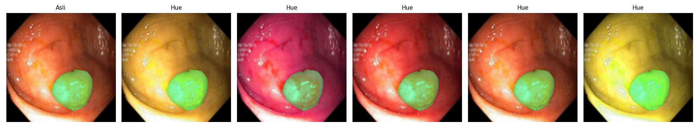
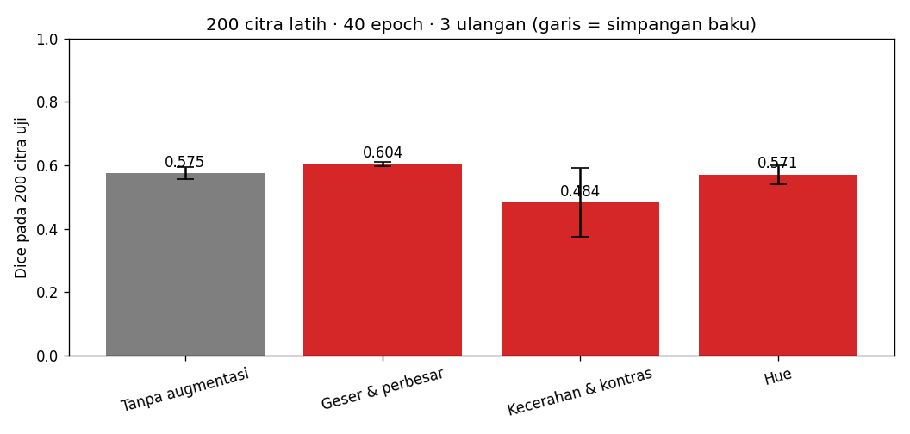
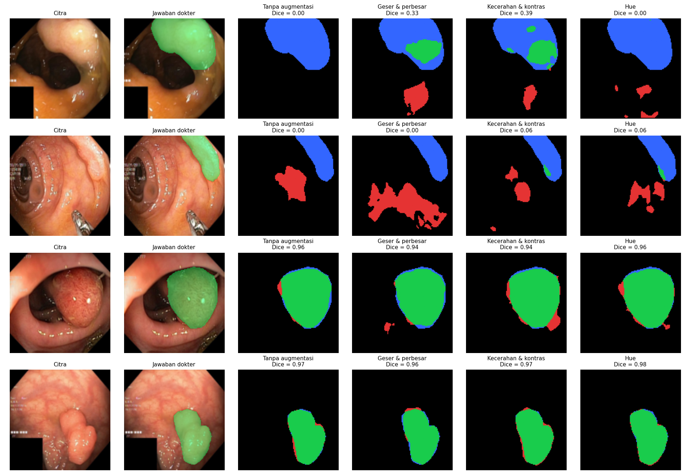

# Segmentasi Polip pada Citra Kolonoskopi dengan U-Net

<!--
  TEMPLATE LAPORAN — Tugas P10 Kecerdasan Buatan (BM25-41204), Teknik Biomedis ITERA.
  Petunjuk lengkap: https://mctm.web.id/ai-bm/tugas

  Cara memakai:
  - Ganti semua teks yang diawali "✍️" dengan tulisan kelompokmu, lalu hapus tanda ✍️-nya.
  - Blok komentar seperti ini adalah petunjuk; tidak tampil di GitHub. Boleh dihapus.
  - Gambar diambil dari folder hasil/ yang dibuat otomatis oleh notebook.
  - Jangan hapus judul-judul bagian (##).
-->

**Tugas P10 — Kecerdasan Buatan (BM25-41204), Teknik Biomedis ITERA**

## Anggota kelompok

| Nama | NIM | Username GitHub | Kontribusi utama |
|---|---|---|---|
| Jonathan Gilbert Ry | 123430063 | jonathan123430063 | ✍️ |
| Wangga Firza Illahi Fasya | 123430029 | Wangga08082005 | ✍️ |
| ✍️ | ✍️ | ✍️ | ✍️ |

## 1. Pertanyaan

Augmentasi apa yang membantu U-Net menemukan polip pada citra kolonoskopi, dan augmentasi apa yang tidak? Kenapa?

## 2. Data & pengaturan

<!-- Isi dari Bagian 2 notebook. Pastikan CEPAT = False untuk hasil akhir. -->

- Dataset: Kvasir-SEG (1000 citra kolonoskopi + mask polip), diperkecil ke 128 × 128 piksel.
- Data uji: 200 citra (tetap). Data latih: 200 citra per ulangan (dipilih dari 800 citra sisa).
- Model: U-Net mini (±0,5 juta parameter), 40 epoch, 3 ulangan per skenario.
- Dijalankan di: Google Colab (GPU T4).


## 3. Skenario augmentasi & hipotesis

<!-- Tulis bagian ini SEBELUM menjalankan eksperimen. Commit dulu, baru jalankan.
     Alasan klinis = kenapa variasi ini mungkin (atau tidak mungkin) terjadi pada kolonoskopi sungguhan. -->

| Skenario | Augmentasi (kode) | Alasan klinis | Hipotesis: Dice naik/turun/sama? |
|---|---|---|---|
| Tanpa augmentasi | — | Pembanding | — |
| Geser & perbesar | `v2.RandomAffine(degrees=0, translate=(0.1, 0.1), scale=(0.8, 1.2))` | Polip bisa tampil di posisi dan ukuran yang berbeda pada foto, tergantung jarak dan sudut kamera. Citra dan *mask* digeser dan diperbesar dengan cara yang sama, jadi polip tetap pas dengan labelnya. | Dice naik sedikit dibanding "Tanpa augmentasi". Dengan hanya 200 citra latih, model mudah *overfitting*. Variasi ukuran dan posisi membuat model belajar bentuk polip, bukan ukuran atau letak tertentu. Selisih dianggap bermakna jika lebih besar dari simpangan baku antar ulangan. |
| Kecerahan & kontras | `v2.ColorJitter(brightness=0.3, contrast=0.3)` | Kecerahan dan kontras foto kolonoskopi berbeda-beda karena kondisi pengambilan foto tidak sama, misalnya intensitas cahaya, jarak kamera, dan jenis kamera. Jika data latih kurang bervariasi, model lebih sering salah pada foto yang kecerahan atau kontrasnya berbeda dari data latihnya. | Dice sama dibanding "Tanpa augmentasi" (selisih lebih kecil dari simpangan baku antar ulangan), karena variasi kecerahan dan kontras di 200 citra latih sudah cukup banyak sehingga tambahan dari augmentasi ini tidak banyak mengubah apa yang dipelajari model. |

Contoh augmentasi yang dicoba:




## 4. Hasil

<!-- Tempel isi hasil/ringkasan.md di sini. -->

✍️ tempel tabel dari `hasil/ringkasan.md`



## 5. Analisis peta kesalahan



<!-- Hijau = benar, merah = false positive, biru = false negative.
     Pertanyaan pemandu: Polip seperti apa yang sering terlewat (kecil? datar? warna mirip dinding usus?)
     Apa yang sering dikira polip padahal bukan? Apakah augmentasi memperbaiki kasus sulit? -->

✍️

## 6. Pembahasan & kesimpulan

<!-- Bandingkan hasil dengan hipotesis di Bagian 3. Hipotesis yang ternyata salah tetap bernilai,
     asalkan dijelaskan kenapa. Perbedaan kecil (lebih kecil dari simpangan baku) belum tentu berarti. -->

✍️

## 7. Pembagian kerja

<!-- Siapa mengerjakan apa. Penilaian proses kerja dilihat dari riwayat commit tiap anggota. -->

✍️

## 8. Penggunaan AI

<!-- Bagian ini ditulis berdasarkan pemakaian sampai sebelum eksperimen akhir. Perbarui setelah eksperimen akhir dan Bagian 4-7 selesai. -->

**Jonathan Gilbert Ry** memakai Claude (Anthropic) lewat aplikasi desktop Claude yang dapat mengubah file repo dan membuka Google Colab di browser. Pemakaiannya:

- Memandu langkah *git* (membuat `.gitignore`, *clone*, *commit*, *push*). Semua perintah *git* dijalankan sendiri oleh Jonathan dari laptopnya.
- Mengusulkan tiga skenario augmentasi (geser & perbesar, kecerahan & kontras, *hue*) dan pembagiannya antaranggota. Kelompok yang menentukan pilihan akhirnya.
- Mengganti isi `SKENARIO` di notebook dengan ketiga skenario tersebut, lalu menjalankan notebook di Colab dalam mode cepat (`CEPAT = True`) untuk memastikan tidak ada *error*. Hasil mode cepat tidak dipakai di laporan ini.
- Mengisi Bagian 2 dan nama file gambar contoh augmentasi di README.
- Hipotesis skenario "Geser & perbesar" berasal dari draf Jonathan. Claude mengoreksi alasannya (manfaat augmentasi ini lebih mungkin datang dari variasi ukuran daripada letak polip, karena lapisan konvolusi pada U-Net relatif tidak bergantung pada posisi) dan merapikan bahasanya.

**Wangga Firza Illahi Fasya:** memakai Claude (Anthropic) lewat halaman chat web (claude.ai), bukan lewat agen yang mengubah file repo. Semua perintah *git* dan semua perubahan pada README dijalankan dan diketik sendiri oleh Wangga dari laptopnya. Pemakaiannya:

- Menjelaskan aturan tugas dan alur kerjanya.
- Memandu pemasangan dan penggunaan Git, GitHub CLI, dan Google Colab, serta menjelaskan pesan *error* di terminal.
- Untuk hipotesis skenario "Kecerahan & kontras": mengajukan pertanyaan pemandu, mengoreksi konsep (augmentasi ini menambah variasi di data latih, bukan menyeragamkan citra), dan merapikan bahasa jawaban Wangga. Alasan klinis dan arah hipotesis (Dice sama) berasal dari jawaban dan pilihan Wangga sendiri.

**Rendi Prayoga:** ✍️ (diisi sendiri oleh yang bersangkutan, tulis "Tidak memakai AI" jika memang tidak)

## Cara menjalankan ulang

```bash
uv sync
uv run jupyter lab segmentasi_polip.ipynb
```

Atau buka notebook di Google Colab (Runtime → Change runtime type → T4 GPU).

## Referensi

- Jha, D., dkk. (2020). Kvasir-SEG: A Segmented Polyp Dataset. *MultiMedia Modeling (MMM 2020)*, 451–462.
- Ronneberger, O., Fischer, P., & Brox, T. (2015). U-Net: Convolutional Networks for Biomedical Image Segmentation. *MICCAI*. arXiv:1505.04597.
- ✍️ tambahkan referensi lain yang kalian pakai
