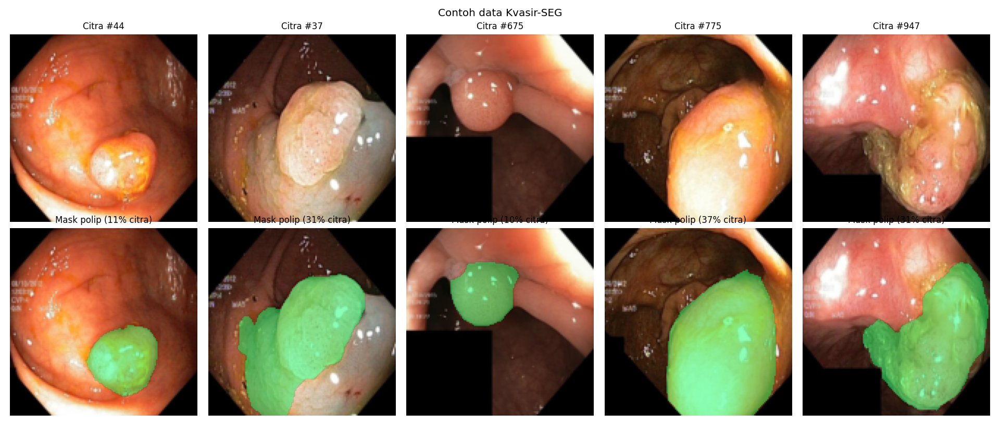
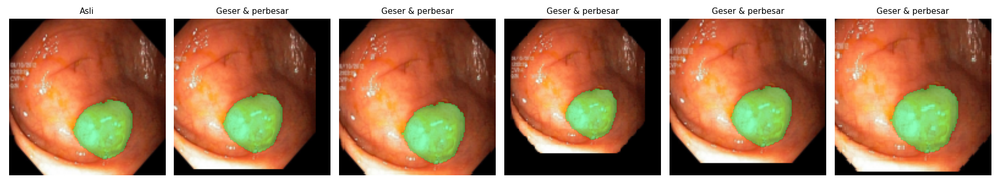
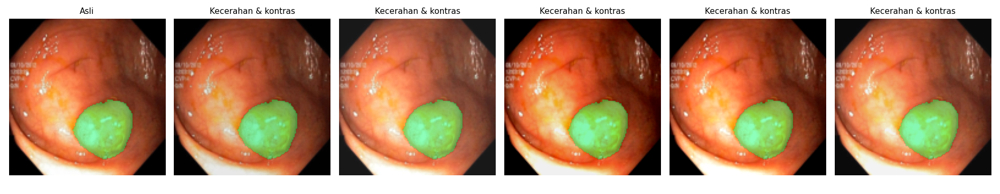

# Segmentasi Polip pada Citra Kolonoskopi dengan U-Net

<!--
  TEMPLATE LAPORAN — Tugas P10 Kecerdasan Buatan (BM25-41204), Teknik Biomedis ITERA.
  Petunjuk lengkap: https://mctm.web.id/ai-bm/tugas

  Cara memakai:
  - Ganti semua teks yang diawali "✍️" dengan tulisan kelompokmu, lalu hapus tanda ✍️-nya.
  - Blok komentar seperti ini adalah petunjuk; tidak tampil di GitHub. Boleh dihapus.
  - Gambar diambil dari folder hasil/ yang dibuat otomatis oleh notebook.
  - Jangan hapus judul-judul bagian (##).
-->

**Tugas P10 — Kecerdasan Buatan (BM25-41204), Teknik Biomedis ITERA**

## Anggota kelompok

| Nama | NIM | Username GitHub | Kontribusi utama |
|---|---|---|---|
| Jonathan Gilbert Ry | 123430063 | jonathan123430063 | Menjalankan eksperimen akhir di Colab, mengganti skenario augmentasi di notebook, dan menulis Bagian 2, 4, 5, dan 6 README |
| Wangga Firza Illahi Fasya | 123430029 | Wangga08082005 | Ketua kelompok dan pemilik repositori, menulis alasan klinis dan hipotesis skenario Kecerahan & kontras serta membahas hasilnya di Bagian 6 |
| Rendi Prayoga | 123430127 | rendi123430127 | Menulis alasan klinis dan hipotesis skenario Hue serta membahas hasilnya di Bagian 6	 |

## 1. Pertanyaan

Augmentasi apa yang membantu U-Net menemukan polip pada citra kolonoskopi, dan augmentasi apa yang tidak? Kenapa?

## 2. Data & pengaturan

<!-- Isi dari Bagian 2 notebook. Pastikan CEPAT = False untuk hasil akhir. -->

- Dataset: Kvasir-SEG (1000 citra kolonoskopi + mask polip), diperkecil ke 128 × 128 piksel.
- Data uji: 200 citra (tetap). Data latih: 200 citra per ulangan (dipilih dari 800 citra sisa).
- Model: U-Net mini (±0,5 juta parameter), 40 epoch, 3 ulangan per skenario.
- Dijalankan di: Google Colab (GPU T4).



## 3. Skenario augmentasi & hipotesis

<!-- Tulis bagian ini SEBELUM menjalankan eksperimen. Commit dulu, baru jalankan.
     Alasan klinis = kenapa variasi ini mungkin (atau tidak mungkin) terjadi pada kolonoskopi sungguhan. -->

| Skenario | Augmentasi (kode) | Alasan klinis | Hipotesis: Dice naik/turun/sama? |
|---|---|---|---|
| Tanpa augmentasi | — | Pembanding | — |
| Geser & perbesar | `v2.RandomAffine(degrees=0, translate=(0.1, 0.1), scale=(0.8, 1.2))` | Polip bisa tampil di posisi dan ukuran yang berbeda pada foto, tergantung jarak dan sudut kamera. Citra dan *mask* digeser dan diperbesar dengan cara yang sama, jadi polip tetap pas dengan labelnya. | Dice naik sedikit dibanding "Tanpa augmentasi". Dengan hanya 200 citra latih, model mudah *overfitting*. Variasi ukuran dan posisi membuat model belajar bentuk polip, bukan ukuran atau letak tertentu. Selisih dianggap bermakna jika lebih besar dari simpangan baku antar ulangan. |
| Kecerahan & kontras | `v2.ColorJitter(brightness=0.3, contrast=0.3)` | Kecerahan dan kontras foto kolonoskopi berbeda-beda karena kondisi pengambilan foto tidak sama, misalnya intensitas cahaya, jarak kamera, dan jenis kamera. Jika data latih kurang bervariasi, model lebih sering salah pada foto yang kecerahan atau kontrasnya berbeda dari data latihnya. | Dice sama dibanding "Tanpa augmentasi" (selisih lebih kecil dari simpangan baku antar ulangan), karena variasi kecerahan dan kontras di 200 citra latih sudah cukup banyak sehingga tambahan dari augmentasi ini tidak banyak mengubah apa yang dipelajari model. |
| Hue | v2.ColorJitter(hue=0.1) | Warna foto kolonoskopi bisa berbeda antar alat dan antar pemeriksaan karena perbedaan keseimbangan putih (white balance), pemrosesan warna kamera, dan warna sumber cahaya. Pada augmentasi ini rona warna (hue) citra digeser sampai ±0,1 dari lingkaran warna, sedangkan mask tidak diubah karena augmentasi warna tidak mengubah posisi, bentuk, maupun batas polip. | Dice naik dibanding "Tanpa augmentasi", karena variasi warna membantu model mempelajari karakteristik polip pada kondisi warna yang berbeda, sehingga lebih mampu mengenali polip pada citra yang bervariasi. Pergeseran ±0,1 relatif kecil, sehingga karakteristik utama polip, yaitu bentuk, tekstur, batas area, dan perbedaannya dengan jaringan di sekitarnya, diharapkan tetap dapat dikenali model. |
Contoh augmentasi yang dicoba:






## 4. Hasil

Hasil akhir (`CEPAT = False`; 200 citra latih, 40 epoch, 3 ulangan per skenario; dijalankan di Google Colab dengan GPU T4). Dice dan IoU dihitung pada 200 citra uji yang tetap. Angka di bawah dibaca langsung dari `hasil/ringkasan.md`.

| Skenario | Dice (rata-rata ± sb) | IoU (rata-rata ± sb) | Dice tiap ulangan |
|---|---|---|---|
| Tanpa augmentasi | 0.575 ± 0.020 | 0.463 ± 0.016 | 0.548, 0.592, 0.586 |
| Geser & perbesar | 0.604 ± 0.007 | 0.483 ± 0.008 | 0.596, 0.613, 0.603 |
| Kecerahan & kontras | 0.484 ± 0.109 | 0.387 ± 0.094 | 0.615, 0.347, 0.488 |
| Hue | 0.571 ± 0.029 | 0.460 ± 0.027 | 0.579, 0.602, 0.532 |

Catatan: *sb* adalah simpangan baku populasi (`np.std` dengan `ddof=0`) dari 3 ulangan. Dengan jumlah ulangan sekecil ini, nilainya sekitar 18% lebih kecil daripada simpangan baku sampel.


## 5. Analisis peta kesalahan


<!-- Hijau = benar, merah = false positive, biru = false negative.
     Pertanyaan pemandu: Polip seperti apa yang sering terlewat (kecil? datar? warna mirip dinding usus?)
     Apa yang sering dikira polip padahal bukan? Apakah augmentasi memperbaiki kasus sulit? -->

Kode warna: hijau = polip ditemukan dengan benar, merah = *false positive*, biru = *false negative*. Peta dibuat dari model ulangan pertama tiap skenario. Empat citra yang ditampilkan dipilih berdasarkan Dice model *Tanpa augmentasi*: dua paling sulit (baris 1 dan 2) dan dua paling mudah (baris 3 dan 4). Jadi gambar ini bukan sampel acak dari 200 citra uji.

Pada dua baris atas, polip gagal ditemukan dengan baik. Pada baris 2, keempat skenario terlewat hampir total (Dice 0,00–0,06). Pada baris 1, *Tanpa augmentasi* dan *Hue* tidak menemukan polip sama sekali (Dice 0,00), sedangkan *Geser & perbesar* (0,33) dan *Kecerahan & kontras* (0,39) baru menemukan sebagian. Pada dua baris bawah, keempat skenario menemukan polip dengan baik (Dice 0,94–0,98). Selain terlewat, model juga salah menandai lipatan mukosa dan area oranye di dinding usus sebagai polip (merah). Polip yang gagal ditemukan berada di tepi bingkai, dan pada baris 2 warnanya mirip mukosa di sekitarnya. Polip yang berhasil ditemukan berada di dalam bingkai dengan kontras yang jelas. Dugaan ini belum bisa dipastikan karena hanya didasarkan pada empat citra.

## 6. Pembahasan & kesimpulan

<!-- Bandingkan hasil dengan hipotesis di Bagian 3. Hipotesis yang ternyata salah tetap bernilai,
     asalkan dijelaskan kenapa. Perbedaan kecil (lebih kecil dari simpangan baku) belum tentu berarti. -->

Skenario *Geser & perbesar* unggul atas *Tanpa augmentasi* pada ketiga ulangan (Dice 0,604 vs 0,575). Selisihnya 0,029 lebih besar daripada simpangan baku kedua skenario (0,007 dan 0,020), jadi arahnya konsisten dan melebihi variasi antar ulangan, tetapi dengan hanya 3 ulangan hal ini belum bisa dipastikan secara statistik. *Hue* tidak membantu (0,571 vs 0,575; selisih 0,004) karena selisihnya jauh di bawah simpangan baku 0,029. Dugaannya, bentuk dan tekstur polip lebih berperan daripada warna, tetapi hal ini tidak diuji dalam eksperimen ini. *Kecerahan & kontras* belum bisa disimpulkan merusak. Rata-ratanya memang paling rendah (0,484), tetapi ketiga ulangannya (0,615; 0,347; 0,488) tersebar dengan simpangan baku 0,109, sehingga yang terbukti hanya ketidakstabilannya.

Hipotesis skenario *Geser & perbesar* (naik sedikit) sejalan dengan data: Dice naik 0,029 dengan arah yang sama pada tiga ulangan. Namun dengan n = 3, hipotesis ini baru didukung secara arah, bukan secara statistik. Untuk pertanyaan utama, dari tiga augmentasi hanya *Geser & perbesar* yang menunjukkan kecenderungan membantu, mungkin karena menambah variasi ukuran dan posisi polip yang dilihat model. Namun geser dan zoom digabung dalam satu skenario, sehingga efek ukuran tidak bisa dipisahkan dari efek posisi. Keterbatasan lain: hanya 3 ulangan, 200 citra latih, model mini, dan peta kesalahan hanya memuat 4 citra dari ujung tersulit dan termudah.

Hipotesis skenario Kecerahan & kontras adalah Dice sama dengan Tanpa augmentasi. Rata-rata Dice-nya 0,484 dibanding 0,575 (selisih 0,091). Selisih ini lebih besar daripada simpangan baku Tanpa augmentasi (0,020) tetapi lebih kecil daripada simpangan baku Kecerahan & kontras sendiri (0,109), sehingga kriteria "lebih kecil dari simpangan baku" tidak bisa dipakai tanpa menyebut simpangan baku yang mana. Ketiga ulangannya (0,615; 0,347; 0,488) tersebar jauh: ulangan pertama lebih tinggi daripada semua ulangan Tanpa augmentasi (maksimum 0,592), sedangkan ulangan kedua jauh di bawahnya. Karena itu hipotesis "sama" tidak bisa dipastikan, dan "merusak" juga tidak. Yang bisa disimpulkan hanya bahwa hasilnya tidak stabil dan butuh lebih banyak ulangan. Alasan dalam hipotesis (variasi kecerahan di 200 citra latih sudah cukup banyak) tidak diuji dalam eksperimen ini, sehingga berstatus dugaan.

Hipotesis kami untuk Hue adalah naik, tetapi hasilnya 0,571 vs 0,575 (selisih 0,004, jauh di bawah simpangan baku 0,029), sehingga pengaruhnya tidak terlihat. Dugaannya, pergeseran hue mengubah warna seluruh citra sekaligus, sehingga perbedaan warna antara polip dan mukosa tetap sama dan tidak ada petunjuk baru yang bisa dipakai model.


## 7. Pembagian kerja

<!-- Siapa mengerjakan apa. Penilaian proses kerja dilihat dari riwayat commit tiap anggota. -->

Berdasarkan riwayat commit:

- **Jonathan Gilbert Ry:** mengganti `SKENARIO` di notebook, mengisi Bagian 2, menulis hipotesis skenario "Geser & perbesar", menjalankan eksperimen akhir di Google Colab (GPU T4, `CEPAT = False`), men-commit notebook dan folder `hasil/`, serta mengisi tabel Bagian 4.
- **Wangga Firza Illahi Fasya:** pemilik repositori; menulis hipotesis skenario "Kecerahan & kontras".
- **Rendi Prayoga:** menulis alasan klinis dan hipotesis skenario "Hue".
Catatan: commit Rendi 88bb670, 2ce1fb1, dan cf0f72f tidak tertaut ke akun GitHub rendi123430127 karena email git saat itu salah ketik (kurang satu angka). Penulisnya tetap Rendi Prayoga.


## 8. Penggunaan AI

<!-- Bagian ini ditulis berdasarkan pemakaian sampai sebelum eksperimen akhir. Perbarui setelah eksperimen akhir dan Bagian 4-7 selesai. -->

**Jonathan Gilbert Ry** memakai Claude (Anthropic) lewat aplikasi desktop Claude yang dapat mengubah file repo dan mengoperasikan Google Colab di browser. Pemakaiannya:

- *Git:* memandu langkah *git* (`.gitignore`, *clone*, *commit*, *push*). Semua perintah *git* dijalankan sendiri oleh Jonathan dari laptopnya.
- *Eksperimen:* mengusulkan tiga skenario augmentasi dan pembagiannya antaranggota (kelompok yang menentukan pilihan akhirnya), mengganti isi `SKENARIO` di notebook, menguji mode cepat (`CEPAT = True`, hasilnya tidak dipakai di laporan), lalu menjalankan eksperimen akhir di Colab (`CEPAT = False`) dan menyalin notebook serta folder `hasil/` ke folder repo di laptop.
- *README:* mengisi Bagian 2 dan nama gambar contoh augmentasi, menyusun tabel Bagian 4 dari `hasil/ringkasan.md`, menyusun Bagian 7 dari riwayat commit dan membantu menuliskan kalimat "Kontribusi utama" Jonathan (isinya diperiksa dan disetujui Jonathan), serta menulis paragraf pembuka Bagian 5 (kode warna dan cara empat citra dipilih) setelah memeriksa kode notebook.
- *Koreksi dan perapian bahasa:* hipotesis skenario "Geser & perbesar" berasal dari draf Jonathan, dan Claude mengoreksi alasannya (manfaat augmentasi ini lebih mungkin datang dari variasi ukuran daripada letak polip, karena lapisan konvolusi pada U-Net relatif tidak bergantung pada posisi). Pada draf Bagian 5, Claude mengoreksi tiga klaim (lumen gelap, warna polip pada baris 1, dan jumlah skenario yang gagal pada baris 1). Untuk Bagian 6, Claude membuat kerangka enam poin lewat pertanyaan berpilihan, lalu Jonathan menulis paragrafnya sendiri; Claude mengoreksi satu kesalahan angka (simpangan baku yang dibandingkan dengan selisih Dice "Geser & perbesar") dan merapikan bahasanya. Pengamatan, dugaan, dan kesimpulan berasal dari Jonathan.

**Wangga Firza Illahi Fasya:** memakai Claude (Anthropic) lewat halaman chat web (claude.ai), bukan lewat agen yang mengubah file repo. Semua perintah *git* dan semua perubahan pada README dijalankan dan diketik sendiri oleh Wangga dari laptopnya. Pemakaiannya:

- Menjelaskan aturan tugas dan alur kerjanya.
- Memandu pemasangan dan penggunaan Git, GitHub CLI, dan Google Colab, serta menjelaskan pesan *error* di terminal.
- Untuk hipotesis skenario "Kecerahan & kontras": mengajukan pertanyaan pemandu, mengoreksi konsep (augmentasi ini menambah variasi di data latih, bukan menyeragamkan citra), dan merapikan bahasa jawaban Wangga. Alasan klinis dan arah hipotesis (Dice sama) berasal dari jawaban dan pilihan Wangga sendiri.
- Untuk Bagian 6, jawaban Wangga tentang hipotesis Kecerahan & kontras dikirim ke Claude, yang mengoreksi satu klaim (rata-rata dianggap tidak mewakili satu pun ulangan, padahal ulangan ketiga dekat dengan rata-rata) dan merapikan bahasanya. Isi dan pendapatnya berasal dari Wangga

**Rendi Prayoga:** memakai Claude (Anthropic) lewat aplikasi desktop Claude. Pemakaiannya: memandu langkah git (memasang git, clone, commit, push), memeriksa konsep alasan klinis dan hipotesis skenario "Hue", dan merapikan bahasanya. Isi hipotesis berasal dari jawaban Rendi sendiri, sedangkan Claude mengoreksi alasan klinis (menyebut variasi yang tepat, yaitu white balance, bukan pencahayaan) dan merapikan kalimat.
Untuk Bagian 6, draf dugaan tentang Hue dikirim lewat Claude, yang mengoreksi alasannya (pergeseran hue mengubah warna seluruh citra sekaligus) dan merapikan bahasanya. Dugaan awalnya berasal dari Rendi.

## Cara menjalankan ulang

```bash
uv sync
uv run jupyter lab segmentasi_polip.ipynb
```

Atau buka notebook di Google Colab (Runtime → Change runtime type → T4 GPU).

## Referensi

- Jha, D., dkk. (2020). Kvasir-SEG: A Segmented Polyp Dataset. *MultiMedia Modeling (MMM 2020)*, 451–462.
- Ronneberger, O., Fischer, P., & Brox, T. (2015). U-Net: Convolutional Networks for Biomedical Image Segmentation. *MICCAI*. arXiv:1505.04597.
